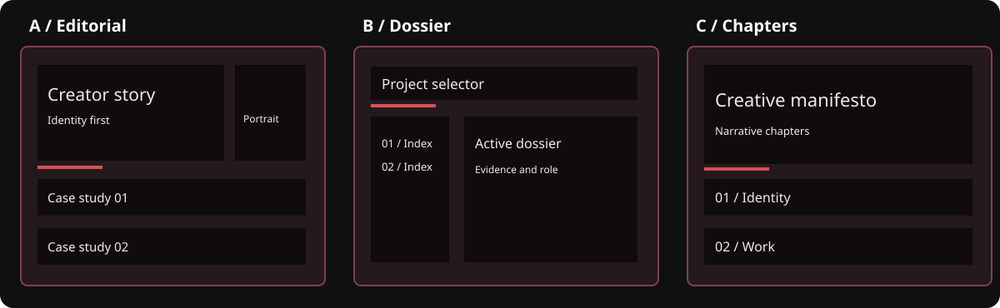

# CreativeCode Engine

**A practical creative direction and design-review toolkit for AI-assisted coding.**

[](https://github.com/faysalishere/creativecode-engine/actions/workflows/tests.yml)


**Current version: `v0.2.0` — Design Intelligence pilot.** The free, offline Python CLI offers three curated concept architectures, declared structural difference checks and an evidence-gated critic packet. An AI assistant is optional for open-ended creative reasoning, and is not included in this repository.

> **What this is:** an open-source toolkit of design principles, AI prompts, a local curated concept CLI, originality heuristics and evidence-first design reviews.  
> **What it isn't:** a trained AI model, a VS Code extension, an autonomous website generator, a visual originality judge or a hosted product.

## Live interactive demo

**Explore:** [CreativeCode Engine design study](https://faysalishere.github.io/creativecode-engine/) · [Open the full three-direction portfolio pilot](https://faysalishere.github.io/creativecode-engine/demo/portfolio/)

The static, dependency-free GitHub Pages demo lets you compare structural design directions and try the existing bilingual portfolio study. It is **a concept demonstration, not a hosted AI generator**. If Pages has not yet been enabled, the repository owner can follow [the one-time deployment instructions](docs/GITHUB_PAGES.md).

## Why CreativeCode?

AI can produce functioning code while recycling predictable layouts: oversized hero cards, arbitrary emoji, irrelevant gradients and cosmetic-only variants. CreativeCode requires deliberate design decisions, three meaningfully different concepts and an evidence-backed critique *before* implementation. It preserves existing project decisions, and it never treats a subjective score as proof of design quality.

## Three directions, not three color swaps



These **schematic wireframes** illustrate differences in hierarchy, navigation and content organization. The repository also contains a real, local bilingual [interactive concept viewer](examples/portfolio_preview/index.html) (not a live production site).

### Try the V1.2 CLI (Python 3.10+, no packages)

```bash
python3 -m creativecode concepts --brief examples/portfolio_brief.json --out concepts.json
python3 -m creativecode originality --concepts concepts.json --out originality.json
python3 -m creativecode critique --brief examples/portfolio_brief.json --concepts concepts.json --out critic.json
```

Supported brief types: `portfolio`, `directory`, `product`. The output describes **curated starting structures**, not novel AI-generated code. Structural checking compares declared labels—not screenshots. Details: [V1.2 guide](docs/V1_2_DESIGN_INTELLIGENCE.md).

## First result in about two minutes

**Without installing anything:** [Try the 2-minute browser test](https://faysalishere.github.io/creativecode-engine/#quick-test). Compare three structures, select one or **Not sure**, and optionally copy feedback to [issue #1](https://github.com/faysalishere/creativecode-engine/issues/1). The demo does not collect responses.

**Python 3.10+ and Git already installed?** Follow the [two-minute CLI quick start](docs/QUICK_START.md) to generate `concepts.json`. This is **curated rule-based output**, not an AI model. Our [real-user study protocol](docs/USER_TESTING.md) tracks meaningful attempts rather than stars.

## Quick start (5–10 minutes)

**1. Get the project.** On GitHub, choose **Code → Download ZIP**, or clone it:

```sh
git clone https://github.com/faysalishere/creativecode-engine.git
cd creativecode-engine
```

**2. Give your AI assistant these files** (paste their text or attach them):

- `01_DESIGN_RULEBOOK.md`
- `02_CREATIVE_WORKFLOW.md`
- `prompts/creative_director.md`
- `examples/sample_brief.md` (replace with your own brief when ready)

Ask: *"Follow the creative director prompt and the rulebook. Give me three structurally different concepts, not code. Explain the differences and unresolved assumptions."*

**3. Review the concepts.** Supply `03_REVIEW_SCORECARD.md` and `prompts/design_critic.md` in a separate review. Do **not** mark visual, functional or accessibility tests as passed unless you have evidence. Choose a concept yourself; don't let an AI score make the final approval.

**4. Run the score calculator** (optional; requires Python 3.10+ and no external packages):

```sh
python3 tools/score.py examples/sample_review.json
python3 -m unittest discover -s tools -p 'test_*.py' -v
```

The included review is **fictional example data**. Its `UNVERIFIED` result is expected because no actual app was tested.

**5. Implement only after approval.** For a real codebase, read `prompts/implementation_engineer.md` and ask the assistant to inspect existing source before editing. Build and test in an isolated development environment; never assume a prompt authorizes deployment.

See [the detailed usage guide](docs/USAGE.md) and [বাংলায় শুরু করার নির্দেশনা](docs/GETTING_STARTED.bn.md).

## What's included?

| Path | What it does |
| --- | --- |
| `01_DESIGN_RULEBOOK.md` | Visual hierarchy, anti-generic rules, responsiveness, accessibility, motion and architecture |
| `02_CREATIVE_WORKFLOW.md` | Scope → research → distinct concepts → critique → approval → prototype → QA |
| `03_REVIEW_SCORECARD.md` | Nine weighted criteria, hard gates, evidence rules |
| `prompts/creative_director.md` | Create three substantive design concepts |
| `prompts/design_critic.md` | Challenge generic or unsupported design decisions |
| `prompts/implementation_engineer.md` | Implement one approved concept with minimal changes |
| `creativecode/` | Curated concept generator, structural comparison and evidence-gated critic packets |
| `tools/score.py` | Local standard-library score calculation and hard-gate validation |
| `tools/test_score.py` | Unit tests of valid/invalid ratings and release gates |
| `examples/sample_brief.md` | Fictional, privacy-safe example brief |
| `examples/three_concepts.md` | Example of three structurally different approaches |
| `examples/sample_review.json` | Fictional scorecard input; **not** real QA evidence |
| `docs/` | V1.2 guide, practical usage, Bangla instructions, launch kit and attribution |

## Scoring principles

The score is a weighted sum of human/AI-supplied ratings from 0–5, normalized to 100. Passing all the hard gates is required even to become a *candidate for human approval*. A `fail` returns `BLOCKED`; `not_tested` returns `UNVERIFIED`. The tool does **not** inspect screenshots, verify licenses, execute Playwright, or generate code. Read [the full rubric](03_REVIEW_SCORECARD.md).

## Compatibility and privacy

- Files are plain Markdown and JSON; use them with any model that can receive file content.
- The Python script uses only the standard library and does not call an API or upload data.
- A separate AI provider may have its own subscription, usage limits or data-handling policy.
- Keep private client briefs, personal data and production secrets out of public issues and repository files. Provide AI services only the information you are permitted to share.
- The Python engine does not call a model API, autonomously browse, or host a model-powered demo; the separate GitHub Pages site hosts a static design study. Optional local browser QA needs Playwright/Chromium installed separately.

## Project status

- **v0.2.0:** offline three-direction concept CLI, structural heuristics, critic packet and bilingual local concept viewer.
- **v0.1.0:** manual prompts, design rulebook and score calculator.
- **Not included:** autonomous AI coding agent, hosted platform or production deployment.

## Contributing and security

Contributions are welcome. See [CONTRIBUTING.md](CONTRIBUTING.md) for scope and checks and [SECURITY.md](SECURITY.md) for reporting concerns. Please open an issue describing the problem before proposing architectural rewrites.

## License and credits

MIT licensed. See [LICENSE](LICENSE) and [docs/ATTRIBUTION.md](docs/ATTRIBUTION.md). Upstream design references are acknowledged but are **not** distributed as part of this repository.

---

## V1.2 technical reference (`v0.2.0`)

The latest release includes **local, deterministic** concept architecture tools. They provide three different starting structures from a JSON brief, compare declared structural differences, and prepare an evidence-based review packet. **They do not run an AI model or certify visual originality.**

```bash
python3 -m creativecode concepts --brief examples/portfolio_brief.json --out examples/portfolio_concepts.json
python3 -m creativecode originality --concepts examples/portfolio_concepts.json --out examples/portfolio_originality.json
python3 -m creativecode critique --brief examples/portfolio_brief.json --concepts examples/portfolio_concepts.json --out examples/portfolio_critic_packet.json
python3 -m unittest discover -s tools -p 'test_*.py' -v
```

Start with [`docs/V1_2_DESIGN_INTELLIGENCE.md`](docs/V1_2_DESIGN_INTELLIGENCE.md) for supported project types, limitations and the portfolio pilot. To inspect three actual structural mockups, open [`examples/portfolio_preview/index.html`](examples/portfolio_preview/index.html) locally. For genuine AI interpretation, use [`prompts/v1_2_creative_model.md`](prompts/v1_2_creative_model.md) in your preferred AI assistant. For an independent review, use [`prompts/v1_2_critical_review.md`](prompts/v1_2_critical_review.md).

The portfolio pilot does **not** modify or deploy the live portfolio. Any implementation direction still requires user approval.


Release details: [v0.2.0 notes](RELEASE_NOTES.md) · [Community launch kit](docs/LAUNCH_KIT.md) · [Give focused feedback](https://github.com/faysalishere/creativecode-engine/issues/1) · [All issues](https://github.com/faysalishere/creativecode-engine/issues).
